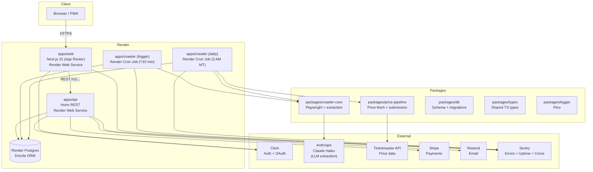

# Concert Crawl

A concert calendar for Denver that crawls venue websites daily to produce an accurate, filterable, searchable event listing.

## Architecture



## Monorepo Structure

```
apps/
  api/        Hono REST API (/v1/...)
  web/        Next.js 15 (App Router) — UI + admin
  crawler/    Playwright + Claude Haiku extraction (two Render Cron Jobs)
packages/
  config/         Shared ESLint, TypeScript, Tailwind configs
  crawler-core/   Playwright browser + extraction logic
  db/             Drizzle ORM schema, migrations, seed
  logger/         Shared Pino logger
  price-pipeline/ Price fetch + community submission pipeline
  types/          Shared TypeScript types
```

## Prerequisites

- [Node.js](https://nodejs.org) >= 20
- [pnpm](https://pnpm.io) >= 10 (`npm install -g pnpm`)
- [OrbStack](https://orbstack.dev) or Docker Desktop

## Getting Started

```bash
# 1. Start local Postgres
docker compose up -d

# 2. Install dependencies
pnpm install

# 3. Set up environment variables
cp apps/api/.env.example apps/api/.env.local
cp apps/web/.env.example apps/web/.env.local
cp apps/crawler/.env.example apps/crawler/.env.local

# 4. Run migrations and seed the database
pnpm db:migrate
pnpm db:seed

# 5. Start all apps
pnpm dev
```

| Service  | URL                   |
| -------- | --------------------- |
| Web      | http://localhost:3000 |
| API      | http://localhost:3001 |
| Postgres | localhost:5433        |

## Common Commands

```bash
pnpm dev          # Start all apps in watch mode
pnpm build        # Build all apps and packages
pnpm test         # Run all tests
pnpm typecheck    # TypeScript check across all packages
pnpm lint         # ESLint across all packages
pnpm db:generate  # Generate a new migration from schema changes
pnpm db:migrate   # Apply pending migrations
pnpm db:seed      # Seed local database with Denver venues
```

## Tech Stack

| Concern       | Choice                                      |
| ------------- | ------------------------------------------- |
| Monorepo      | Turborepo + pnpm workspaces                 |
| API           | Hono 4                                      |
| Web           | Next.js 15 (App Router)                     |
| Auth          | Clerk                                       |
| Database      | PostgreSQL 16 + Drizzle ORM                 |
| Crawler       | Playwright + Claude Haiku (LLM fallback)    |
| Styling       | Tailwind CSS + shadcn/ui                    |
| Testing       | Vitest (unit/integration), Playwright (E2E) |
| Observability | Sentry (errors, uptime, crons)              |
| CI            | GitHub Actions                              |
| Hosting       | Render (API + Web + Cron Jobs + Postgres)   |

## API Client (Bruno)

The full API collection (56 endpoints) lives at `apps/api/bruno/` and is ready to open in [Bruno](https://www.usebruno.com) (free desktop app).

**Setup:**

1. Install Bruno from [usebruno.com](https://www.usebruno.com)
2. Open Bruno → **Open Collection** → select `apps/api/bruno/`
3. In the top-right environment selector, choose **local**
4. Paste your Clerk dev session token into the `adminToken` variable:
   - Sign in to the app at `http://localhost:3000`
   - Open browser DevTools → Application → Cookies → find `__session`
5. Requests under `admin/` are pre-configured with `Bearer {{adminToken}}`

Run `pnpm dev` before sending requests.

## Tool Belt

Third-party services this app depends on:

- [Render](https://render.com): Hosting for the API, web app, and managed Postgres database
- [Clerk](https://clerk.com): Authentication and user management (supports Spotify OAuth)
- [Anthropic](https://anthropic.com): Claude Haiku LLM used as fallback for crawl data extraction
- [Stripe](https://stripe.com): Payments and subscription billing
- [Resend](https://resend.com): Transactional email delivery
- [Sentry](https://sentry.io): Error tracking, uptime monitoring, and cron monitoring across all three apps
- [Cloudflare](https://cloudflare.com): Domain registrar for `concertcrawl.app`
- [GitHub Actions](https://github.com/features/actions): CI/CD pipelines, integration tests, E2E tests, and smoke test cron

## Contributing

- Branches: `feat/short-description`, `fix/short-description`
- Commits follow [Conventional Commits](https://www.conventionalcommits.org) (enforced by commitlint)
- All CI checks must pass before merging to `main`
- Never commit `.env.local` files
