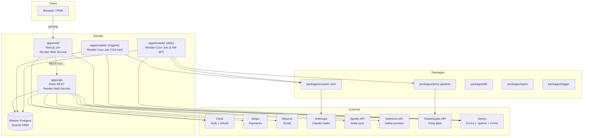

# Concert Crawl — Beta to Launch Plan

**Date:** 2026-05-09  
**Status:** Active — supersedes the roadmap section of the 2026-04-23 design spec  
**Scope:** Everything from private beta (May 25) through public launch (target Aug 18–22)

---

## Current Product State

As of 2026-05-09, the following phases are complete and merged to `main`:

| Phase | Description | PR(s) |
|---|---|---|
| 1 | Foundation | — |
| 2 | Venue Management (Admin) | — |
| 3 | Crawler v1 | — |
| 4 | Design System / Theming | — |
| 5 | Consumer Calendar UI | — |
| 5b | Consumer UI Polish | #22–24 |
| 6a | Observability SDK (Pino + Sentry) | #26 |
| 6b | Integration Tests (Vitest) | #28 |
| 6c | E2E + Smoke Tests (Playwright) | #29 |
| 7 | Automation + Scheduling (cron) | #34 |
| 7.5 | IdentityArt generative engine | #39 |
| 7.6 | Admin UI Redesign | #44, #50 |
| 8a | Beta Launch Prep — Landing + Auth | #43, #45 |
| 8b pt.1 | User Profile + Settings | #49 |
| — | Price Transparency v2 | #46 |
| — | Betterment: Crawler separation from API | #51 |

### Monorepo packages (current)

```
packages/
├── config/          # Shared ESLint, TypeScript, Tailwind
├── crawler-core/    # Playwright + extraction logic (separated from API in PR #51)
├── db/              # Drizzle ORM schema + migrations
├── logger/          # Shared Pino logger
├── price-pipeline/  # Price fetch + submission pipeline (extracted from packages/crawler-core in PR #51)
└── types/           # Shared TypeScript types
```

### Data as of beta open

- Venues crawling: Red Rocks Amphitheatre, Ogden Theatre (2 active)
- Events in DB: ~200
- Target before beta: add Mission Ballroom + Fillmore (4 total)

---

## Monetization Model

### Tiers

| Tier | Price | Features |
|---|---|---|
| **Free** | $0 forever | Browse, search, filter, save shows (Watching), price transparency, community price submissions |
| **Supporter** | $2/month | Free + concert history, calendar export (iCal + Google), supporter badge |
| **Premium** | $5/month | All Supporter + artist following + new show alerts, Spotify sync, price drop alerts |
| **Founder** | $3/month, locked forever | Full Premium at a permanent discount |

All new users get a **14-day free trial of Premium** at signup. No credit card required to start.

### Founder window

First 100 Founders **or** 30 days after launch, whichever comes first. After the window closes, the $3 tier disappears from the UI permanently. Founder badge appears on profile.

### Active vs. passive split

The Supporter / Premium split is logical, not arbitrary:

- **Supporter ($2)** covers features with near-zero ongoing server cost — personal history and export that run on existing infrastructure.
- **Premium ($5)** covers features that require active backend work — notification workers running continuously, email delivery at volume, Spotify API calls, price-polling jobs.

### Pricing framing

"Making the app better, not making money." Premium funds the infrastructure that makes the active features reliable. The cost is real and should be communicated honestly in the upgrade flow.

### Beta preview users

The 10–20 private beta users receive lifetime Premium access at no cost. This is administered via Clerk `publicMetadata`:

```json
{ "role": "user", "plan": "premium_gifted" }
```

Set manually per user in the Clerk dashboard. No Stripe subscription row required. The auth layer checks for `premium_gifted` before checking Stripe. Founders are a separate, post-launch cohort with real Stripe subscriptions (`subscriptions.founder = true`).

---

## Pre-Beta Checklist (target: May 25)

Hard blockers — nothing ships to beta users without these:

| Item | Notes |
|---|---|
| **Saving shows (Watching)** | Heart button → `user_events` table, Phase 8b Part 2. Design handoff complete (`design_handoff_watching/`). |
| **Browse filters wired** | Date, venue, price, vibe → URL params, `applyFilters()` hooked up. Currently broken. Designs complete: `design_handoff_phase5b_screens/Browse Home.html` + `Browse Desktop.html`. |
| **Search implementation** | Command palette (⌘K on desktop, full-screen on mobile). Four states: empty, artist match, venue match, no results. Currently a dead nav link. Designs complete: `design_handoff_phase5b_screens/Search Desktop.html` + `Search Mobile.html`. |
| **Artist genre data** | `genre: text[]` exists on the events table but is sparsely populated. LLM extraction must be verified to consistently output genre tags before Event Detail v2 can surface them. Audit crawler output and patch extraction prompt if needed. |
| **Full UI interactions sweep** | Walk every clickable element on every route. Log dead interactions. Fix blockers. |
| **Invite code error states** | Invalid code, expired code, no-code wall (separate from onboarding flow — these are code-entry failures). |
| **Feedback modal** | In-app, auth-only, rate-limited (1/hour). Category + message + auto-captured page URL → `feedback` table. |
| **Empty states** | Per-route — browse (no results for filters), search (no results), Watching (no saved shows). |
| **FounderNote copy** | Hugh writes the personal message for onboarding step 1 before beta opens. |
| **FounderNote admin page** | `app_config` table (key-value), simple admin editor so copy can be updated without a redeploy. |
| **Legal for beta** | One-page "private beta, don't share" doc. T&C + Privacy Policy required before public launch. |
| **Seed additional venues** | Add Mission Ballroom + Fillmore to active crawl before May 25. |

---

## Beta Period Plan (Jun 16 – Aug 3)

Hugh is on vacation May 27 – June 13. Beta opens May 25 and runs unattended during that period — intentional. Real usage data from friends/colleagues with no developer on call produces higher-quality feedback than monitored week-1 impressions. Hugh returns June 13–14, with June 16 as the resumption of active development.

~20% capacity in each week is reserved for beta bug triage and feedback-driven work.

| Week | Dates | Focus |
|---|---|---|
| 1 | Jun 16–22 | Beta feedback review + bug triage. Reactive by design — let findings drive it. Error/loading sweep. |
| 2 | Jun 23–29 | Cost tracking admin feature + polish (404 page, sign-out → landing transition, returning-user onboarding edge). |
| 3 | Jun 30 – Jul 6 | Stripe integration: subscription tiers, upgrade flow, gifted premium mechanism in auth layer. |
| 4 | Jul 7–13 | First premium features: concert history, calendar export (iCal + Google), supporter badge. |
| 5 | Jul 14–20 | Surprise features: shareable show cards (IdentityArt) + "who else is watching" aggregate count. |
| 6 | Jul 21–27 | Engaging features: setlist preview, venue first-timer guide, "last time in Denver" data point. |
| 7 | Jul 28 – Aug 3 | Spotify sync import (connect account → populate `user_artist_follows`). Teaser UI for artist following notifications (shell only — alerts are a launch feature). |

---

## Launch Prep (Aug 4–17, 2 weeks)

Two full weeks. Do not compress this.

### Security
- Full API auth audit (all routes, role middleware, session expiry)
- Rate limiting verified on all endpoints
- CORS locked to production origin only
- Zod coverage sweep (all endpoints validated)
- Dependabot alerts cleared
- Secrets audit (no keys in git, all env vars documented in `.env.example`)
- Run the `security-review` Claude Code skill against the full codebase

### Legal
- Privacy Policy (data collected, how used, retention period, deletion rights)
- Terms of Service (user conduct, crawling disclosure, DMCA, refund policy)
- Cookie/analytics disclosure (PostHog)
- Bot transparency page at `concertcrawl.app/bot`
- GDPR: user data export + deletion endpoints verified end-to-end

### Regression testing
- Full E2E suite green on staging
- Smoke tests verified on prod
- Manual walkthrough: sign up → browse → save → submit price → dispute → profile → settings → upgrade → delete account
- Cross-browser: Chrome, Safari, Firefox (mobile + desktop)

### Monitoring + alerting
- Sentry alert rules configured (error rate thresholds, new issue types)
- Sentry Uptime monitoring active on all three services (replaces UptimeRobot)
- Sentry Crons monitoring active on daily crawler job (replaces Grafana crawl alert)
- Render native dashboard reviewed (CPU, memory, request counts baseline)
- Cost tracking dashboard reviewed — know baseline before launch traffic
- Crawl health: at least 2 clean weeks of crawl history before launch

### Performance
- Core Web Vitals pass (LCP, CLS, FID — especially mobile)
- Image lazy loading verified
- API response time baseline documented

### Launch checklist
- `app_config` FounderNote updated to launch voice (vs. beta voice)
- Founder window configured (100-person cap or 30-day timer)
- Stripe live mode keys configured in Render production environment
- Smoke tests `SMOKE_ENABLED=true` set in GitHub `production` environment

---

## Launch Target

**~August 18–22, 2026.** Maximum August 31.

---

## Observability Stack

Simplified to two systems:

| Concern | Tool |
|---|---|
| Errors + performance + uptime + crons | **Sentry** |
| Infrastructure metrics + logs | **Render native** (CPU, memory, request counts, log drain) |

No Grafana. No UptimeRobot. Pino structured logs flow to Render's log drain. Sentry handles everything else.

---

## Issue Tracking

**GitHub Issues + GitHub Projects (v2).** Zero additional systems, automatic PR linkage, free forever.

Suggested label taxonomy:

| Label | Values |
|---|---|
| `type:` | bug, feature, polish, chore |
| `source:` | beta-feedback, internal |
| `phase:` | pre-beta, beta, launch |
| `priority:` | blocker, high, normal |

---

## Feature Backlog

### Viral / Engaging Features

Features that make users share the app or return to it more often. Not algorithm-driven — deliberately human and surprising.

| Feature | Description | Bucket |
|---|---|---|
| **Shareable show cards** | IdentityArt-generated cards for saved/attended shows. Instagram story (9:16), square (1:1), link preview. | Beta |
| **"Who else is watching"** | Aggregate count of Concert Crawl users who saved a show. Number only — no names. | Beta |
| **Concert passport** | Visual grid of attended shows, styled like stamps. Designed to screenshot and share. Natural extension of concert history. | Launch |
| **Setlist preview** | Most recent tour setlist via Setlist.fm API (free, no approval). Collapsed by default in Event Detail. Degrades gracefully if no data. | Launch |
| **Venue first-timer guide** | Static per-venue card: parking, entry policy, age restriction, bag rules, "bring cash or not", doors-to-show gap. Editorial, not crawled. Red Rocks especially. | Launch |
| **Support act spotlight** | Surface the opener prominently — same card weight as headliner. How people discover new artists. | Launch |
| **"Last time in Denver"** | When did this artist last play a show in our events database. Derived from crawl history. City from `user_profiles.city`, defaults to Denver. | Launch |
| **Concert Roulette** | One random upcoming Denver show, shuffle-style. "I'm feeling lucky." No algorithm. Hold as a surprise — don't tease. | Post-launch |

### Premium Features

Features behind the Supporter or Premium paywall at launch.

| Feature | Tier | Technical notes |
|---|---|---|
| Concert history | Supporter | `user_events.status = 'attended'`. Filter past events. Simple. |
| Calendar export | Supporter | iCal file generation (standard) + Google Calendar URL scheme. Effectively free to operate. |
| Supporter badge | Supporter | Cosmetic. Shown on profile. |
| Artist following | Premium | `user_artist_follows` table exists. Follow button on artist name anywhere it appears. |
| New show alerts | Premium | Background job matches new crawled events against followed artists. Notification delivery via Resend (email) + PWA push. Smart batching: multiple events same day = single digest. 60-day lookahead default. Per-artist: instant vs. daily digest preference. **Launch feature — not beta.** |
| Spotify sync | Premium | Clerk Spotify OAuth → Spotify Web API → populate `user_artist_follows`. Fuzzy artist name matching required. Ships during beta period (week 7). Alerts are a launch feature. |
| Price drop alerts | Premium | Compare price snapshots. Alert when `price_min` drops for a watched event. Notification via Resend. **Launch feature.** |
| Founder tier | Founder | $3/month locked. First 100 or 30 days post-launch. Founder badge. |

---

## Design Queue

### Beta bucket (needed before or during beta period)

1. **Event Detail v2** — Port price trail + sourcing from price transparency into layout. Add submit-a-price entry point inline. Add setlist preview stub (collapsed). Add "who else is watching" as togglable element. Core layout from phase5b stands — this is additive.
2. **Shareable show cards** — Three formats: 9:16, 1:1, link preview. Hooks into IdentityArt engine.
3. **Monetization upgrade flow** — Tier comparison (Supporter / Premium / Founder), payment modal, trial CTA, Founder urgency treatment.
4. **Concert history / passport view** — Past attended shows. Empty state is the primary experience ("Your concert history starts here"). No import/backfill at launch.

### Launch bucket (needed before public launch)

5. **Artist following UI** — Follow button on artist name (event card, event detail, venue page). Distinct from Watching heart button.
6. **Venue first-timer guide surface** — Static content card on venue profile.
7. **Notification preferences settings** — Per-artist instant vs. digest, 60-day threshold toggle, delivery time preference.
8. **"Last time in Denver" treatment** — How does this data point appear on event detail / artist surfaces?
9. **Support act spotlight treatment** — Opener card weight and placement.

---

## Notification Design Principles

For artist following alerts (launch feature):

- **Smart batching:** Multiple followed-artist events announced same day → single notification ("3 new shows from artists you follow")
- **Digest option:** User chooses instant vs. daily digest at a chosen time
- **60-day lookahead:** Don't notify about shows more than 2 months out by default (configurable)
- **Per-artist preference:** Instant for some, weekly digest for others
- **Mental model separation:** Following an artist does NOT auto-watch their announced shows. Follow = alert. Watch = track this specific event's price.

---

## Artist Following vs. Watching — Model Distinction

| Action | Scope | What it does | Where it lives |
|---|---|---|---|
| **Watch (heart)** | Event-level | Track this show; get price change alerts | Event card, Event Detail |
| **Follow** | Artist-level | Get notified when artist announces a Denver show | Artist name (event card, Event Detail, Venue page) |

These are separate affordances with separate buttons. Following an artist does not auto-watch their shows. Notification settings reflect this split: artist following → new show alerts; watching → price change alerts.

---

## FounderNote Admin Page

The onboarding step 1 message (Hugh's personal note) is stored as a row in an `app_config` table (key-value: `key text, value text, updated_at timestamp`). A simple admin editor at `/admin/config` allows updating the message without a redeploy. The message will change at minimum twice: once for beta voice, once for launch voice.

---

## Architecture Diagram (README)

The root `README.md` should include a Mermaid architecture diagram showing the system at a glance. Mermaid renders natively on GitHub and can be maintained as code alongside the repo.

The diagram should cover: the three apps, the packages layer, Render services, external services, and data flow.



**Placement:** Root `README.md`, after the project summary and before the local development section.

**Scope note:** This diagram is scoped to the beta period (Week 2, Jun 23–29) — low-effort, high-payoff for any developer or collaborator who opens the repo cold. Update the diagram whenever a new external service or package is added.
